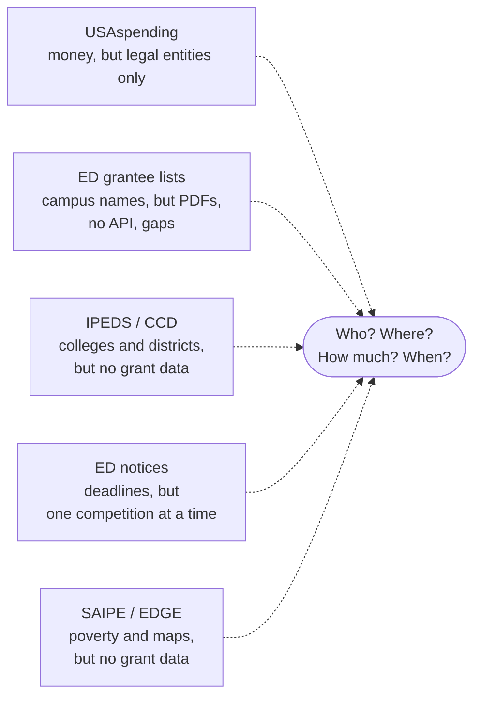
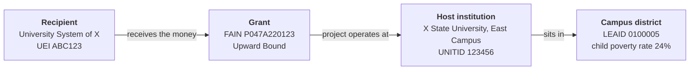
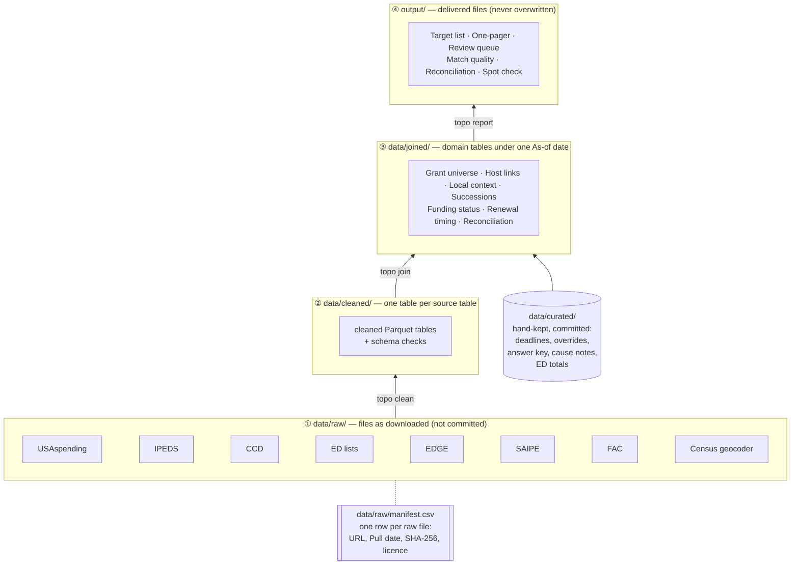
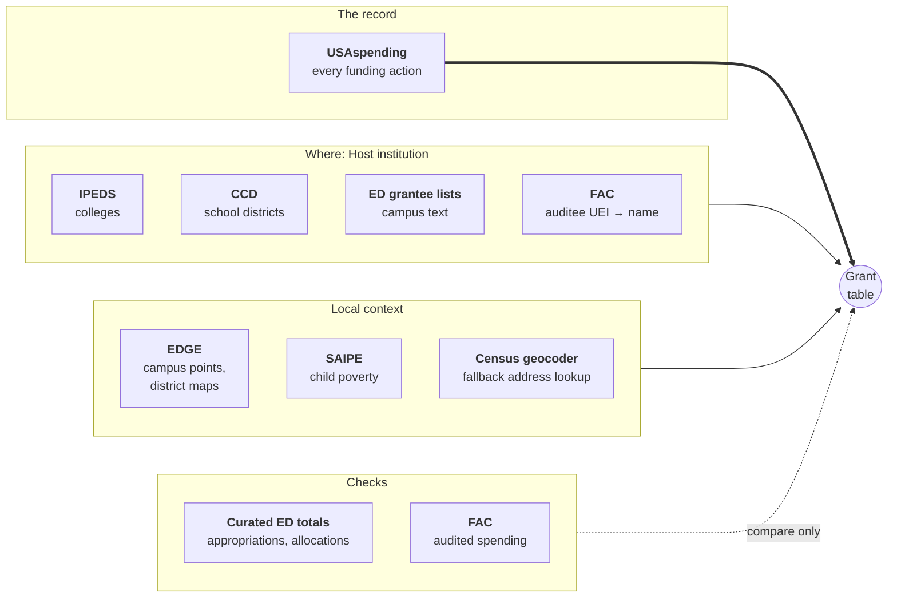
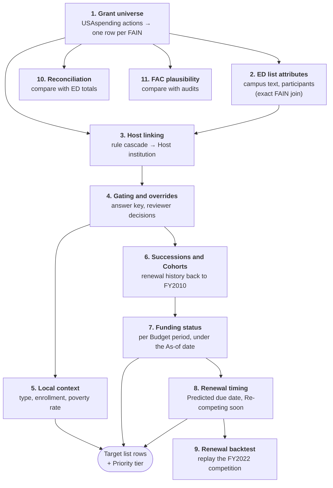
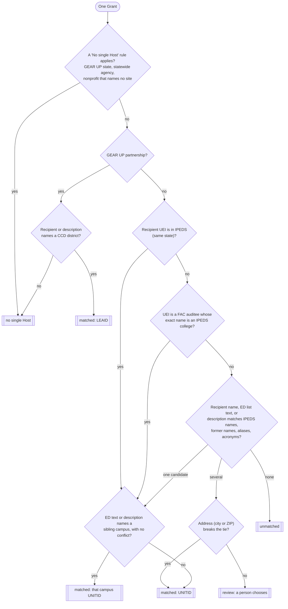
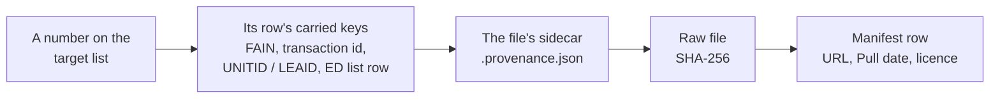
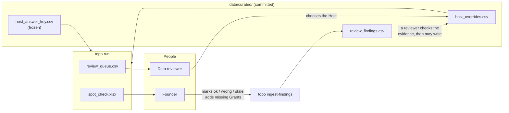

<p align="center">
  
</p>

<p align="center">
  <b>One public-data map of federal TRIO and GEAR UP Grants: who holds them, where, how much, and when they compete again.</b>
</p>

---

**topo** is a Python pipeline. It downloads public federal data, joins it, and checks it. Then it writes a sorted target list of every TRIO and GEAR UP Grant in the reporting window, and a one-page summary.

topo is built for **Elevated Minds**, an education-services company that sells to TRIO and GEAR UP programs. The target list tells the company which programs to contact, and when.

topo works at the **organization level only**. It does not record individual people.

> **About the logo.** A topographic ("topo") map shows height with contour lines. The mountain has four bands, one for each data layer: raw, cleaned, joined, and output. Each layer is a step higher. At the summit is the target list. The sun behind the summit is for Elevated Minds.

## Contents

1. [The problem](#1-the-problem)
2. [What topo gives you](#2-what-topo-gives-you)
3. [Key words](#3-key-words)
4. [How topo works: the big picture](#4-how-topo-works-the-big-picture)
5. [The data sources](#5-the-data-sources)
6. [How topo joins the data](#6-how-topo-joins-the-data)
7. [The outputs](#7-the-outputs)
8. [Why you can trust a number: checks and provenance](#8-why-you-can-trust-a-number-checks-and-provenance)
9. [People in the loop](#9-people-in-the-loop)
10. [Quick start](#10-quick-start)
11. [Commands](#11-commands)
12. [Configuration](#12-configuration)
13. [Repository layout](#13-repository-layout)
14. [Limits: what topo does not do](#14-limits-what-topo-does-not-do)
15. [More reading](#15-more-reading)
16. [Data credits](#16-data-credits)

---

## 1. The problem

The U.S. Department of Education (ED) funds two families of college-access programs:

- **TRIO**: seven programs, such as Upward Bound, Talent Search, and Student Support Services. They help low-income and first-generation students.
- **GEAR UP**: grants that follow a whole group of students from middle school through high school.

In FY2026, Congress gave these programs approximately $1.6 billion: $1.191 billion for TRIO and $388 million for GEAR UP. Thousands of colleges, school districts, and nonprofits hold the Grants. Many of them buy services such as tutoring, test prep, and workshops.

An education-services company wants to answer four questions:

| Question | Why it is important |
|---|---|
| **Who** holds a TRIO or GEAR UP Grant? | These are the possible clients. |
| **Where** does each project operate? | Sales work is by state and by campus. |
| **How much** money does each Grant get, and does it continue? | Size and stability show which programs can buy. |
| **When** does each Grant compete again? | A program writes its partners into its proposal. If you are named in a winning proposal, you are in the budget for five years. You must know 6 to 12 months before the deadline. |

### Why this is difficult

No single public source answers all four questions.



The specific problems are:

1. **The money record names the wrong entity.** USAspending names the **Recipient**: the legal entity that receives the money. A university *system* can be the Recipient for a project that operates at one *campus*. A nonprofit can be the Recipient for a project that operates in a school district. The place where the project operates (the **Host institution**) is not in the record.
2. **Programs share numbers.** Upward Bound, Upward Bound Math and Science, and Veterans Upward Bound all use assistance listing 84.047. Only the first five characters of the Grant ID (the FAIN) tell them apart.
3. **Funding gaps are routine, and causes are not public.** In 2025 and 2026, federal policy stopped or delayed some TRIO funding. But even in a normal year (2024), 95 Grants had a funding gap. No public source gives the cause per Grant.
4. **Competition dates are not published early.** ED announces a competition only months before the deadline. But TRIO programs compete on a 5-year cycle, so you can predict the next deadline from the last one.
5. **ED's own lists are hard to use.** ED publishes grantee lists as PDFs and spreadsheets on pages that block automated download. Some years and programs are missing.

Today, the founder of Elevated Minds finds new Grants mostly by word of mouth, usually after the money has arrived. topo replaces this with a complete, sorted, and checked list.

---

## 2. What topo gives you

topo makes one run and delivers these files. Each file name contains the **Pull date** (the date the data was downloaded).

| Output | What it is | Who uses it |
|---|---|---|
| **Target list** (`.xlsx` and `.csv`) | One row per Grant. It shows the Recipient, Host institution, Program, amounts per fiscal year, Funding status, Lifecycle stage, Predicted due date, local context, and a **Priority tier** (call order). | Sales |
| **One-pager** (`.md` and `.pdf`) | A plain-language summary: what is out there, what changed since 2025, what is coming up, and how far to trust it. | Founder |
| **Review queue** (`.csv`) | Grants where a person must choose the Host institution, sorted by dollars. | Data reviewer |
| **Match-quality report** (`.md`) | How well topo linked Grants to Host institutions, with accuracy per rule. | Data reviewer |
| **Reconciliation table** (`.csv`) | topo's totals compared with ED's published totals, row by row, with reasons for each gap. | Data reviewer |
| **FAC plausibility table** (`.csv`) | Audited spending compared with federal obligations, as a size check only. | Data reviewer |
| **Spot-check copy** (`.xlsx`) | A locked copy of the target list for the founder to mark "ok", "wrong", or "stale". | Founder |

### The Priority tier

The target list sorts by Priority tier. A tier is a call-order bucket. It is **not** a score.

| Tier | Meaning | Why call |
|:---:|---|---|
| **1** | **New**: awarded within the last 3 months | The program is hiring, planning, and spending start-up money. |
| **2** | **Re-competing soon**: the next competition deadline is 12 months or less away | The program is writing a proposal and choosing partners. |
| **3** | **Continuing** | The program plans services before each budget year. |
| **4** | **Unfunded or reversed** | Shown with its reason. **This is not a call list.** |

Ended Grants have no tier. They go on a separate "Ended" sheet.

---

## 3. Key words

topo uses a small set of exact words. The full list is in [`GLOSSARY.md`](GLOSSARY.md). The most important words are:

| Word | Meaning |
|---|---|
| **Grant** | One funded project for one project period. Its ID is the **FAIN**. A renewal is a *new* Grant with a new FAIN. |
| **Recipient** | The legal entity that receives the money. Its ID is the **UEI**. |
| **Host institution** | The college or school district where the project operates. Its ID is the **UNITID** (college) or **LEAID** (district). It can be different from the Recipient. |
| **Program** | One grant program, for example Talent Search. |
| **Budget period** | Approximately 12 months of a Grant, funded by one action. |
| **Continuation** | A yearly action that funds the next Budget period of the same Grant. |
| **Cohort** | All the Grants of one Program from one competition. |
| **Succession** | The link from a Grant to the next Grant that renewed it (same Recipient, Program, and Host). |
| **Funding status** | What happened to the funding of one Budget period: *continued*, *funded late*, *unfunded*, *reversed*, or *not yet readable*. It shows a **pattern, never a cause**. |
| **Lifecycle stage** | Where a Grant is in its project period: new, continuing, final Budget period, ended, or re-competing soon. |
| **Predicted due date** | The expected deadline of a Program's next competition. |
| **As-of date** | The date at which a run reads the data. All statuses are calculated for this date. |
| **Pull date** | The date a source file was downloaded. |

### Recipient and Host institution are different

This difference is the most important idea in topo.



A sales contact works at the Host institution, not at the system office. So topo must find the Host institution for every Grant.

---

## 4. How topo works: the big picture

topo moves data up through four layers. Each layer is rebuilt from the layer below it.



| Step | Command | What it does |
|---|---|---|
| **Pull** | `topo pull <source>` | Downloads one source into `data/raw/<source>/<Pull date>/`. Adds one row per file to the manifest. |
| **Clean** | `topo clean <source>` | Reads only the columns topo needs. Makes types and codes consistent. Checks the schema. |
| **Join** | `topo join` | Builds every domain table under one As-of date. |
| **Report** | `topo report` | Writes the delivered files. Each file gets a provenance sidecar. |
| **Run** | `topo run` | Does clean, join, and report in sequence. |

The tools are Python 3.14, [uv](https://docs.astral.sh/uv/), [Polars](https://pola.rs/), [DuckDB](https://duckdb.org/) (with the spatial extension for maps), [Pandera](https://pandera.readthedocs.io/) (schemas), [Typer](https://typer.tiangolo.com/) (command line), openpyxl (Excel), and fpdf2 (PDF).

---

## 5. The data sources

topo uses eight sources and a small set of hand-kept files. **USAspending is the record.** All other sources add attributes or check the record. No other source can create a Grant.



### Source table

| Source | Publisher | What topo takes from it | How topo gets it | Used for |
|---|---|---|---|---|
| **USAspending Award Data Archive** | U.S. Treasury | Every assistance action on the TRIO and GEAR UP listings, FY2010 to now: FAIN, Recipient UEI and name, amounts, dates, descriptions | `topo pull usaspending` (bulk archive files for ED) | The Grant record, amounts, Funding status, Successions, Cohorts |
| **IPEDS directory and fall enrollment** | NCES, through the Urban Institute Education Data Portal | Every college since 2015: names, former names, aliases, UEIs, state, sector, merges, enrollment | `topo pull ipeds` (bulk CSV) | Host linking for colleges, institution type, enrollment |
| **CCD school district directory** | NCES, through the Urban Institute Education Data Portal | Every school district since 2015: name, state, city, ZIP, agency type, enrollment | `topo pull ccd` (bulk CSV) | Host linking for GEAR UP districts, district context |
| **ED TRIO and GEAR UP grantee lists** | U.S. Department of Education | Per Program and year: the "Recipient / campus" text, participant counts, ED's amounts | **Downloaded by hand** (ed.gov blocks scripts). Each file has a row with its SHA-256 in `data/raw/manifest.csv`. | Host linking signal, reconciliation |
| **NCES EDGE** | NCES | Campus latitude and longitude per college; school district boundary polygons | `topo pull edge` (zip files) | Find the Campus district for each college Host |
| **SAIPE school districts** | U.S. Census Bureau | Children aged 5–17, and the number in poverty, per district | `topo pull saipe` (one flat file) | The child poverty rate in Local context |
| **Census geocoder** | U.S. Census Bureau | The school district at a street address | `topo pull census_geocoder` (one call per campus, only after a first run) | Fallback for colleges with no EDGE campus point |
| **Federal Audit Clearinghouse (FAC)** | GSA | Single Audit lines on the TRIO and GEAR UP listings: auditee UEI and name, amount expended | `topo pull fac` (bulk CSV, approximately 1.4 GB) | A plausibility check, and one Host linking signal |
| **Curated files** (`data/curated/`) | People, from cited public pages | Competition deadlines, ED appropriations and allocations, cause notes, Host overrides, answer key | Typed by hand. Each row cites its source. | Renewal timing, reconciliation, cause notes, Host linking review |

### Rules for every source

- **Bulk files only.** topo downloads the published bulk files. It does not call the Urban Institute `/api/`, because that site's `robots.txt` does not allow it. topo stops if you configure an `/api/` URL.
- **No personal data.** topo never reads the DUNS columns or the highly-compensated-officer columns from USAspending. It never reads contact names, emails, phone numbers, or EINs from FAC.
- **Every raw file has a manifest row.** The row records the source, the URL or request, the Pull date, the size, the SHA-256 hash, and the licence.
- **A missing source does not stop the run.** If you never pulled a source, its `clean` step does nothing. The run continues, and the affected fields show a reason code. For example, with no IPEDS pull, colleges show as `unmatched`.

### How topo finds TRIO and GEAR UP Grants

topo selects Grants by **assistance listing number plus the first five FAIN characters**. It never selects by awarding agency. (Some ED Grants are administered by another agency, and they must stay in.)

| Program | Family | Listing | FAIN prefix |
|---|---|---|---|
| Student Support Services | TRIO | 84.042 | `P042A` |
| Talent Search | TRIO | 84.044 | `P044A` |
| Upward Bound | TRIO | 84.047 | `P047A` |
| Upward Bound Math and Science | TRIO | 84.047 | `P047M` |
| Veterans Upward Bound | TRIO | 84.047 | `P047V` |
| Educational Opportunity Centers | TRIO | 84.066 | `P066A` |
| Ronald E. McNair | TRIO | 84.217 | `P217A` |
| GEAR UP partnership | GEAR UP | 84.334 | `P334A` |
| GEAR UP state | GEAR UP | 84.334 | `P334S` |

An action on one of these listings with an unknown FAIN prefix goes to an **exceptions** table. topo does not drop it silently.

---

## 6. How topo joins the data

`topo join` builds the domain tables in this sequence. Each step uses the results of the steps before it.



### Step 1: The Grant universe

topo reads every cleaned USAspending action. It keeps an action when its listing and FAIN prefix name a Program. It groups the actions by FAIN, so one row is one Grant.

A Grant is **in the universe** when its project period overlaps the **reporting window**. The window starts at FY2021 and ends at the last fiscal year that ended before the As-of date. So the window moves forward without a change to the configuration.

Amounts are always **obligations by federal fiscal year of the action date**, labelled like "FY2025". A federal fiscal year starts on 1 October. topo never labels an amount with an academic year.

### Step 2: ED grantee list attributes

topo joins the ED TRIO lists to the Grants **by exact FAIN only**. The list adds the "Recipient / campus" text and participant counts. In a year with no list, these fields are blank, not zero.

ED's amounts **never** go to the target list. They are used only for reconciliation (step 10).

### Step 3: Host linking

Host linking finds the college or district where each project operates. It is a **deterministic rule cascade** ([ADR 0002](docs/adr/0002-host-linking-is-a-rule-cascade-gated-by-case-label-accuracy.md)). There is no machine-learning model and no numeric confidence score. The rule that makes the decision gives its name to the Grant. This name is the **Case label**, for example `uei_confirmed`.



The diagram is simplified. These policies also apply:

- **Same state only**, for every signal.
- **Signal rank:** Recipient UEI first, then the ED list text, then campus words and the award description. Address is only a tiebreak. ED text outranks the description. Any other conflict goes to review.
- **System offices** (IPEDS sector 0) never win over a real campus. If a system office is the only candidate, the Grant goes to review.
- **Merged colleges:** topo uses the college as it was in the Grant's start year. If that record is gone, it uses the surviving college in the same state.
- **GEAR UP partnerships** link to a school district, never to the college partner.
- **No DUNS data.** A Grant with no UEI is matched on name, ED text, and description only, and it is flagged `no_uei`.

There are four possible outcomes. topo keeps them separate and visible:

| Outcome | Meaning |
|---|---|
| **matched** | One Host institution (UNITID or LEAID). |
| **no single Host** | A rule decided that the Grant has no one Host (for example, a statewide GEAR UP Grant). |
| **review** | topo found candidates, and a person must choose. |
| **unmatched** | topo found no candidate. |

A prototype on 4,315 FY2024 Grants gave 85.5% matched, 7.2% no single Host, 6.1% review, and 1.3% unmatched. On a fresh hand check, approximately 99% of automatic decisions were correct. (See [`prototypes/host-linking/`](prototypes/host-linking/).)

### Step 4: Gating and overrides

topo does not assume that a rule is correct. It measures each Case label against a **frozen answer key**: approximately 200 Grants that a person labelled by hand.

| Result on the answer key | What happens |
|---|---|
| Accuracy ≥ 95% with ≥ 10 checks | **Auto-accepted.** The rule's decision stands. |
| Accuracy < 95% with ≥ 10 checks | **Demoted.** All the label's Grants go to review. |
| Fewer than 10 checks | **Unverified.** The decision stands, and the report says "unverified". |

The answer key is frozen. Nobody tunes the rules against it. A separate **tuning set** is used to improve the rules. A FAIN in both files stops the run. When the key is complete, you can pin its SHA-256 in `config.toml`. A later change to the key then stops the run.

After gating, topo applies **overrides**: decisions that a reviewer recorded in `data/curated/host_overrides.csv`. An override always wins. Its Case label is `override`, and topo keeps the rule's original decision beside it.

### Step 5: Local context

Local context describes **where the Host institution is**. It does not describe the students that the project serves. topo attaches context only through the Host. It never uses the Recipient or the state.

| Host type | Institution type | Enrollment | Child poverty rate (ages 5–17) |
|---|---|---|---|
| College (UNITID) | IPEDS sector | IPEDS fall enrollment | SAIPE rate of the **Campus district** |
| School district (LEAID) | CCD agency type | CCD enrollment | SAIPE rate of the district |

To find the Campus district, topo puts the EDGE campus point into the EDGE district polygons (DuckDB spatial). If a college has no EDGE point, topo uses the Census geocoder with the IPEDS street address.

Each value shows its data year. When a value is blank, a **reason code** says why: `no_saipe_row`, `no_campus_district`, `no_enrollment_row`, `no_single_host`, `unmatched`, or `in_review`.

### Step 6: Successions and Cohorts

To predict renewals, topo must see past renewals. So it also reads older Grants (the **lookback**): back to FY2010 for TRIO and FY2015 for GEAR UP. Lookback Grants are used only here. They get no amounts and no target-list rows.

- A **Succession** links a Grant to its next Grant with the same Recipient, Program, and Host institution.
- A **hand-off** is a full negative amount on one FAIN, matched to the cent by a same-day new award on another FAIN of the same Program.
- A **Cohort start** is a fiscal year in which a Program made many new awards (at least 50% of its largest yearly count).

### Step 7: Funding status

topo reads the funding actions of each Grant and gives each Budget period a Funding status ([ADR 0001](docs/adr/0001-grant-status-records-funding-patterns-not-causes.md)). The reader is a pure function. It never reads the clock. It ignores actions dated after the As-of date.

The **anniversary** of a Budget period is its start date. topo reads the first positive obligation in these windows:

```text
                       anniversary
                           │
   ◄─── 4 months ───►      │◄ 1 month ►│                  │
───────────────────────────┼───────────┼──────────────────┼──────────────►  time
   undated actions here    │ continued │   funded late    │
   count for this period   │           │                  │
                           │◄────────── 90 days ─────────►│
                                                          │
                     no obligation by here?  →  unfunded
                     (before here, with none →  not yet readable)
```

| Funding status | Rule |
|---|---|
| **continued** | First positive obligation no later than 1 month after the anniversary. |
| **funded late** | First positive obligation after that. |
| **unfunded** | No obligation 90 days after the anniversary. |
| **not yet readable** | No obligation yet, but the 90 days are not over on the As-of date. |
| **reversed** | A negative amount equal to a full positive obligation of the period. Same-day +/− pairs and hand-offs do not count. |

End dates, descriptions, and partial negatives are **never** status signals.

A Grant gets the **2025–26 disruption** marker when funding for a Budget period that started between 1 May 2025 and 30 September 2026 was missing, late, or reversed. The marker stays, even if the money came later. **It is a pattern, not proof of a policy cut.**

A cause appears only as a **cause note**: a curated row that cites a public source (with a docket entry or page) that names the FAIN. topo never guesses a cause from a pattern.

Each run adds its readings to an append-only history (one row per FAIN, Budget period, and As-of date). Thus you can reproduce any published reading.

### Step 8: Renewal timing

TRIO programs compete on a **5-year cycle**. topo predicts the next deadline **per Cohort**, never per Grant:

```text
  prior competition deadline                         Predicted due date
  (from data/curated/deadlines.csv)                  = deadline + 60 months
          │                                                   │
──────────┼───────────────────────────────────────────┬───────┼──────────► time
          │◄──────────────── 60 months ──────────────►│       │
                                                      │◄ 12 ─►│
                                                       months
                                                      │
                                    from here: Re-competing soon (tier 2)
```

- **Evidence tier.** *Notice published*: the deadline file holds the new competition's own deadline. *Inferred*: the date is the last deadline plus 60 months.
- **Re-competing soon** applies when the Predicted due date is 12 months or less after the As-of date, and the latest readable Funding status is continued or funded late. It stays until the new Cohort's FAINs appear in USAspending.
- If a Program's observed gap between Cohorts is not 60 months, topo marks it **"timing not predicted"**. It does not force the rule.
- **GEAR UP** competes most years, so topo does not predict its timing. Instead, its rows show "expires within 12 months" from the Grant's end date.

### Step 9: The renewal backtest

topo tests the renewal rule on the past. For the FY2022 TRIO competition, it sets the As-of date to 12 months before each Program's real deadline. It hides all later data. Then it checks the Re-competing soon flag against what really happened. The rule must reach **95% recall and 95% precision**.

`topo freeze` also **pre-registers** the predictions for the FY2027 competition. It writes them once to `data/curated/fy2027_predictions.csv`. You commit and tag that file, and nobody changes it. After the competition, `topo score-predictions` scores the frozen file into a new file.

### Step 10: Reconciliation

topo compares its totals with ED's published totals ([`topo.domain.reconciliation`](src/topo/domain/reconciliation.py)). It never adjusts the data to close a gap.

| Check | Compares | Tolerance |
|---|---|---|
| `appropriation_vs_allocations` | The TRIO appropriation with the sum of ED's seven program allocations | Shows the remainder |
| `ed_allocation_dollars` | ED's allocation per Program with USAspending obligations | 1% or $1M, whichever is larger |
| `ed_allocation_count` | ED's award count per Program with the number of Grants funded | 1% |
| `ed_list_dollars`, `ed_list_count` | ED grantee-list totals with USAspending | Exact |
| `fac_plausibility` | FAC audited spending with obligations | None (size check only) |

Each row gets a **Reconciliation status** (*reconciled*, *a stated difference*, or *not comparable*). A row that does not reconcile gets a **Gap reason code** from a closed list, with a cited note:

`not_published` · `no_ed_list` · `timing_difference` · `provisional` · `exceeds_appropriation_unexplained` · `plausibility_only` · `unexplained`

The tolerances are fixed in `config.toml` before the first run. Nobody changes them to make a gap go away.

### Step 11: FAC plausibility

FAC records what each organization *spent*, from its audit. USAspending records what the government *obligated*. These are different measures on different calendars, so topo does not reconcile them. Over five fiscal years, they should be of a similar size. topo flags a Recipient for review when the ratio of spent to obligated is below 0.5 or above 1.5. Nothing passes or fails.

---

## 7. The outputs

`topo report` writes these files to `output/`. Each file name contains the Pull date. topo **never overwrites** a delivered file. A second run on the same day writes `_v2`, `_v3`, and so on.

| File | Contents |
|---|---|
| `target_list_<Pull date>.xlsx` | Sheets: README, the target list, Ended, Missing. |
| `target_list_<Pull date>.csv` | The main sheet only. |
| `one_pager_<Pull date>.md` and `.pdf` | The founder's one-page summary. Each headline number has a marker such as "[provisional 1]" that points to a numbered item in "How far to trust this". |
| `review_queue_<Pull date>.csv` | One row per (FAIN, candidate) for each Grant in review. Sorted by dollars, then by Succession impact. |
| `match_quality_<Pull date>.md` | Host linking outcomes by count and dollars, accuracy per Case label, inter-rater agreement, review and unmatched lists, backtest scores, and reason-code counts. |
| `reconciliation_<Pull date>.csv` | One row per check, Program, and fiscal year. |
| `fac_plausibility_<Pull date>.csv` | One row per Recipient UEI and listing. |
| `spot_check_<Pull date>.xlsx` | A locked copy of the target list with three mark columns. |
| `<file>.provenance.json` | The provenance sidecar for each file above. |
| `run_log.parquet` | Append-only row counts per layer per run. |
| `funding_status_history.parquet` | Append-only Funding status readings. |

### Target list columns (summary)

| Group | Columns |
|---|---|
| Call order | **Priority tier**, Label, Tier reason |
| Status | Lifecycle stage, Funding status, Latest readable status, Readable from, 2025–26 disruption, Cause note |
| Who and where | Recipient, Recipient UEI, Host institution, Host ID, State, Host confidence, Case label |
| What | Program, FAIN, Project start, Project end, Award date |
| How much | Latest FY, Latest FY obligation, Cumulative obligation, and one column per fiscal year (`FY2021` …), from USAspending only |
| When | Re-competing soon, Predicted due date, Evidence tier, Predicted competition FY, Renewal timing, End date |
| Local context | Institution type, Enrollment, Poverty rate (ages 5-17), each with its data year; Campus district overlap; Context reason |
| Provenance and review | Data note, Pull date, As-of date, Last founder mark (read-only) |

Rows sort by Priority tier, then by Host confidence (matched first), then by award date, then by state.

---

## 8. Why you can trust a number: checks and provenance

Every number must trace back to its source, its query, and its Pull date ([ADR 0003](docs/adr/0003-provenance-by-carried-keys-and-as-of-snapshots.md)).

### Trace a number



Each **sidecar** records:

- the raw files used, with their SHA-256 hashes
- the git commit of the code
- whether the work tree had uncommitted changes
- the As-of date and the Pull date
- a hash of `config.toml`
- a random run id

### Guards: what stops a run

Only **structural breaks** stop a run. All other problems give a warning.

| Structural break | Why it stops the run |
|---|---|
| Rows lost between layers without a named reason | Every row that goes in must come out, or be counted under a named drop reason in `run_log.parquet`. |
| A duplicate FAIN in the Grant table | One Grant must be one row. |
| A duplicate reconciliation key | One check must be one row. |
| A schema failure at the end of `clean` or `join` | The data shape changed. |
| A changed or missing ED list file | Its bytes or SHA-256 differ from the manifest. |
| A changed frozen answer key | Its SHA-256 differs from the pinned value. |
| **Uncommitted changes in the work tree** | The sidecar could not name the code that made the output. Use `--allow-dirty` to override. |

### Other rules that protect the data

- **The As-of date is an input, never the clock.** The default is the date of the latest USAspending pull. So the same inputs always give the same outputs.
- **Blank is not zero.** A figure that a source did not publish is blank, with a reason code.
- **Append-only files.** The manifest, run log, Funding status history, and review findings only get new rows.
- **Fixed thresholds.** Tolerances, read windows, and pass bars are in `config.toml`. Each assumption is marked `ASSUMPTION`. Nobody tunes them to make a result look better.

---

## 9. People in the loop

Some decisions need a person. topo keeps these decisions in committed files, so they survive every rerun.



| File | Who writes it | What it does |
|---|---|---|
| `host_overrides.csv` | Data reviewer | Sets the Host for a FAIN. The latest dated row wins. The Grant leaves the review queue on the next run. |
| `host_answer_key.csv` | Repository owner; a second reviewer for approximately 40 rows | The frozen key for gating. The double-labelled rows measure agreement between reviewers. |
| `host_tuning_set.csv` | Data reviewer | Examples to improve the rules. Never scored. |
| `review_findings.csv` | `topo ingest-findings` | The founder's spot-check marks. A finding **never** changes an override by itself. |
| `deadlines.csv` | Data reviewer | Past competition deadlines, each with a citation. |
| `cause_notes.csv` | Data reviewer | Cited causes, each naming one FAIN. |
| `appropriations.csv`, `ed_program_allocations.csv` | Data reviewer | ED's published totals for reconciliation. |

---

## 10. Quick start

### Prerequisites

- macOS or Linux
- [uv](https://docs.astral.sh/uv/getting-started/installation/)
- git
- Several GB of free disk space (the FAC awards file alone is approximately 1.4 GB)

### Install

```sh
git clone https://github.com/ikahrilas/topo.git
cd topo
uv sync
uv run pytest        # optional: run the tests
```

### Get the data

1. Download each source:

   ```sh
   uv run topo pull usaspending
   uv run topo pull ipeds
   uv run topo pull ccd
   uv run topo pull edge
   uv run topo pull saipe
   uv run topo pull fac
   ```

2. Download the ED grantee lists by hand. ed.gov blocks scripts. Put each file in `data/raw/ed_grantee_lists/`. Add a row for each file to `data/raw/manifest.csv`, with its SHA-256. The rows that are already in the manifest show the format.

3. Commit the new manifest rows. (topo stops on an uncommitted work tree.)

> **Note:** Some download URLs in `config.toml` are marked `UNVERIFIED`. Check them against the publisher's page before the first pull.

### Run

```sh
uv run topo run
```

This command cleans every source, joins the data, and writes the outputs to `output/`.

To fill in Campus districts for colleges that have no EDGE point, do this after the first run:

```sh
uv run topo pull census_geocoder
uv run topo run
```

To read the data as of a specified date:

```sh
uv run topo run --as-of 2026-10-07
```

### After the run

1. Open `output/target_list_<Pull date>.xlsx`.
2. Read the README sheet first. It explains each column.
3. Give `output/review_queue_<Pull date>.csv` to a data reviewer. Record each decision in `data/curated/host_overrides.csv`.
4. Send `output/spot_check_<Pull date>.xlsx` to the founder. When it comes back, record the marks:

   ```sh
   uv run topo ingest-findings path/to/returned_spot_check.xlsx --date 2026-10-20
   ```

---

## 11. Commands

| Command | What it does |
|---|---|
| `topo pull <source>` | Downloads one source into `data/raw/<source>/<Pull date>/` and adds manifest rows. Option: `--pull-date`. |
| `topo clean <source>` | Cleans the latest pull of one source into `data/cleaned/`. |
| `topo join` | Builds the joined layer under one As-of date. Option: `--as-of`. |
| `topo report` | Writes the outputs from the joined layer. |
| `topo run` | Does `clean` for every source, then `join`, then `report`. Option: `--as-of`. |
| `topo ingest-findings <workbook> --date <date>` | Adds the marks from a returned spot-check copy to `data/curated/review_findings.csv`. |
| `topo freeze` | Writes the pre-registered FY2027 predictions. It does this once only. |
| `topo score-predictions` | Scores the frozen predictions into a new file. |

The sources are `usaspending`, `ipeds`, `ccd`, `ed_grantee_lists` (clean only), `edge`, `saipe`, `fac`, and `census_geocoder`.

All commands accept `--config <path>`. The commands that write layers accept `--allow-dirty`.

---

## 12. Configuration

All settings are in one file: [`config.toml`](config.toml). Each setting has a comment that gives its reason and its source. The most important sections are:

| Section | Controls |
|---|---|
| `[as_of]` | The default As-of date (the latest USAspending pull). |
| `[reporting_window]` | The first fiscal year of the window (FY2021). |
| `[funding_status]` | The read windows (4 months, 1 month, 90 days) and the 2025–26 disruption dates. |
| `[host_linking]` | The gating bar (95%, 10 checks) and the answer-key hash. |
| `[renewal_timing]` | The cycle (60 months) and the lead time (12 months). |
| `[target_list]` | The tier-1 window (3 months) and the reporting-lag window (90 days). |
| `[tolerances]` | The reconciliation tolerances (1% or $1M). |
| `[lookback]` | How far back topo reads for Successions (FY2010 TRIO, FY2015 GEAR UP). |
| `[fac]` | The plausibility span and ratio limits. |
| One section per source | Download URLs and source options. |

No source needs an API key at this time. `[api_keys]` names the environment variable for a Census key (`CENSUS_API_KEY`). Put keys in your shell or in a `.env` file beside `config.toml`. git ignores `.env`. Never put a key in a committed file.

---

## 13. Repository layout

```text
topo/
├── config.toml               all settings
├── GLOSSARY.md               the exact words topo uses
├── src/topo/
│   ├── cli.py                the `topo` command
│   ├── pipeline.py           clean → join → report
│   ├── join.py               builds the joined layer
│   ├── report.py             writes the outputs
│   ├── provenance.py         run id, git state, sidecars
│   ├── guards.py             structural breaks and warnings
│   ├── manifest.py           the raw manifest
│   ├── sources/              one module per source: pull() and clean()
│   ├── domain/               pure rules: grant universe, host linking, funding
│   │                         status, succession, renewal timing, reconciliation …
│   └── outputs/              one module per delivered file
├── data/
│   ├── raw/manifest.csv      committed; the raw files are not
│   ├── curated/              committed hand-kept and frozen inputs
│   ├── cleaned/  joined/     rebuilt on each run (not committed)
├── output/                   delivered files (not committed)
├── tests/                    pytest suite with small synthetic sources
├── prototypes/host-linking/  the first Host linking study
└── docs/
    ├── adr/                  architecture decisions
    ├── research/             source and domain research, with citations
    ├── assumptions/          stated assumptions to confirm
    └── assets/               the logo
```

The `domain/` modules are **pure**: frames go in and frames come out. They do not read files or the clock. This makes them easy to test.

---

## 14. Limits: what topo does not do

- **topo does not give causes.** A funding gap is a pattern. A cause appears only when a public source names the FAIN.
- **topo does not describe the students served.** Local context describes where the Host institution is.
- **topo does not see applicants who lost.** USAspending shows only funded Grants. So the Succession rate is descriptive only.
- **topo does not score or rank inside a tier.** The Priority tier is a bucket.
- **topo does not predict GEAR UP timing.** GEAR UP competes most years.
- **topo does not record individual people.** It records organizations only.
- **USAspending has a reporting lag.** A fiscal year that ended less than 90 days before the Pull date is marked *provisional*.
- **Some ED grantee lists are missing.** The manifest records each known gap as `missing`. Those program-years show `no_ed_list`.
- **Some assumptions are not confirmed yet.** Each one is marked `ASSUMPTION` in `config.toml` or in [`docs/assumptions/`](docs/assumptions/).

---

## 15. More reading

**Architecture decisions**

- [ADR 0001: Grant status records funding patterns, not causes](docs/adr/0001-grant-status-records-funding-patterns-not-causes.md)
- [ADR 0002: Host linking is a rule cascade, gated by per-case accuracy](docs/adr/0002-host-linking-is-a-rule-cascade-gated-by-case-label-accuracy.md)
- [ADR 0003: Provenance by carried keys and as-of snapshots](docs/adr/0003-provenance-by-carried-keys-and-as-of-snapshots.md)

**Research** (in [`docs/research/`](docs/research/))

| Document | Topic |
|---|---|
| `usaspending-trio-gearup.md` | Listings, FAIN prefixes, and USAspending fields |
| `trio-gearup-funding-and-cycles.md` | Appropriations and the 5-year competition cycle |
| `status-signals-2025-26.md` | The 2025–26 disruption and the Funding status rules |
| `recipient-vs-host-institution.md` | Why the Recipient is not the Host |
| `entity-and-geo-sources.md` | IPEDS, CCD, EDGE, and SAIPE |
| `federal-audit-clearinghouse.md` | FAC data and why it is not reconciled |
| `apr-data-and-fy2026-awards.md` | Annual performance reports and the FY2026 awards |
| `program-services-and-incumbency.md` | What each program buys, and incumbent advantage |
| `source-terms-and-cadence.md` | Licences and update schedules |
| `sam-extract-value-and-terms.md` | Why topo does not use the SAM extract |
| `urban-education-data-portal.md` | The Urban Institute portal and its terms |

**Issues** are on [GitHub](https://github.com/ikahrilas/topo/issues).

---

## 16. Data credits

topo republishes public data. Each delivered workbook repeats these credits.

- **USAspending.gov**, U.S. Department of the Treasury, Bureau of the Fiscal Service. Recipient names and addresses include Dun & Bradstreet (D&B) Open Data, republished from USAspending.gov with attribution to D&B.
- **IPEDS and CCD**, through the Education Data Portal, Urban Institute, under the ODC Attribution License.
- **NCES EDGE** campus points and school district boundaries, public domain.
- **U.S. Census Bureau**, Small Area Income and Poverty Estimates (SAIPE). This product uses the Census Bureau Data API but is not endorsed or certified by the Census Bureau.
- **U.S. Department of Education** grantee lists, public domain.
- **Federal Audit Clearinghouse**, GSA, public domain.
